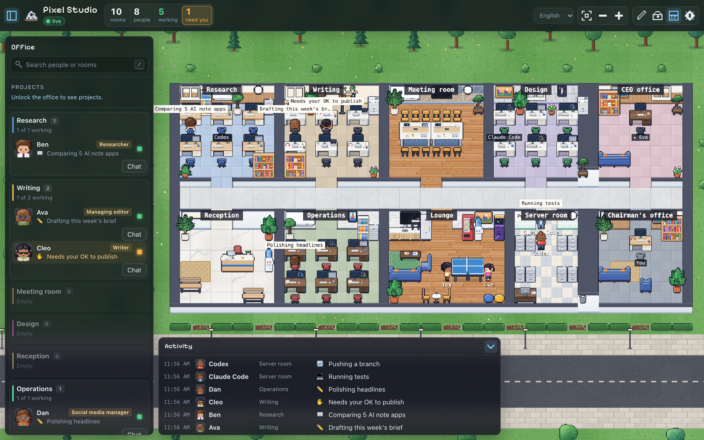

# Barnacle

**A self-hosted pixel office where your AI agents work as a team.**

English · [简体中文](README.zh-CN.md)



Barnacle turns your AI agents into a small company you can watch. Each agent
gets a job title, a soul and skills, a desk in a department, and a pixel
character that walks to its desk to write, to the library to research and to
the server room to run things. They hand work to each other, discuss projects
in threads, write daily reports to their managers, and come to you — the
chairman — for what only you can decide.

It runs on your own server, NAS or laptop. Bring any model: Claude, OpenAI,
Gemini, DeepSeek, MiniMax, OpenRouter, Ollama or any OpenAI-compatible
endpoint. Tools such as Claude Code or Codex can show up in the office too.

> **Status:** early prototype (v0.1). Expect rough edges and breaking changes.

## Features

- **Agents with a soul.** Job title, persona (SOUL), way of working and a skill
  library, each with its own model; layered memory and full-text recall of past
  work.
- **A team, not a list of bots.** Agents ask colleagues and delegate pieces of
  work; projects run as threads where @mentions hand work on, with a planner and
  a summary.
- **A company structure (optional).** Rooms are departments with managers who
  write daily reports; a CEO sums them up and decides what you delegate,
  following your own earlier decisions; your desk shows it all.
- **You stay in charge.** Per-action permissions (allow / ask me / never), an
  inbox for approvals, a results page to accept or send back every delivery
  with its sources, an experience library and skill proposals you approve.
- **Real work in and out.** Attach PDF, Word, Excel, PowerPoint and images to
  tasks; a company and per-department knowledge base agents search and cite;
  deliveries as Word, Excel, CSV or Markdown files.
- **Costs under control.** Tokens and estimated cost for every call, by person,
  department and model; daily and monthly budgets; a lighter model for routine
  work.
- **Connect your tools.** MCP servers (local or remote), each tool behind the
  same approval rules; scheduled tasks; a Claude Code hook and a simple HTTP
  state API.
- **Your office, your layout.** A tile-based floor editor with furniture and
  rooms, desks that belong to people, and a "start a company" wizard with team
  templates.
- English, 日本語 and 繁體中文 interface.

## Quick start

### Docker

```bash
git clone https://github.com/xiaoxiongbaba/barnacle.git
cd barnacle
docker compose up -d
docker compose logs barnacle | grep "office token"
```

### From source (Node.js 22.13+)

```bash
npm install
npm run build
npm start
```

Open <http://localhost:19100>, click the gear in the top-right corner and enter
the **office token** (printed once in the log on first start, and kept in
`data/secret.json`). The **Start a company** wizard then helps you connect a
model and pick a team template; everything can be changed later.

## Bring in your agents

- **Agents in Barnacle**: give any member a model in Settings → Occupants, then
  hand it tasks from its panel, schedule work, or start a project.
- **Claude Code**: hooks that show what Claude Code is doing —
  [integrations/claude-code](integrations/claude-code/README.md).
- **Anything else** that can send an HTTP request:

  ```bash
  curl -X POST http://localhost:19100/api/occupants/me/status \
    -H "Authorization: Bearer $BARNACLE_TOKEN" \
    -H "Content-Type: application/json" \
    -d '{"state":"writing","detail":"Sketching the lobby","name":"Me","kind":"human"}'
  ```

  States: `idle`, `writing`, `researching`, `executing`, `syncing`, `waiting`
  (needs you), `error`, `offline`. See the [state protocol](docs/state-protocol.md).

## Documentation

- [Guide](docs/guide.md) — every feature in detail: models, memory, teamwork,
  projects, the organization, approvals, files, costs, MCP, the floor editor,
  environment variables and art packs
- [State protocol](docs/state-protocol.md) — draft v0.1
- [Mod pack spec](docs/mod-pack-spec.md) — draft v0.1: how anyone can decorate an office
- [Requirements and roadmap](docs/REQUIREMENTS.md) (Chinese)

## Configuration

Most settings live in the page. The environment sets the defaults:

| Variable         | Default       | Meaning                                                    |
| ---------------- | ------------- | ---------------------------------------------------------- |
| `PORT`           | `19100`       | HTTP port                                                  |
| `HOST`           | `0.0.0.0`     | Bind address                                               |
| `DATA_DIR`       | `./data`      | Database, encryption key and token                         |
| `BARNACLE_TOKEN` | generated     | Office token, at least 32 characters                       |
| `BARNACLE_NAME`  | `My Barnacle` | Default office name                                        |
| `BARNACLE_LANG`  | `en`          | Default language: `en`, `ja` or `zh-Hant`                  |

All variables are listed in the [guide](docs/guide.md#environment-variables).
Back up the whole `DATA_DIR`: the database and `master.key` belong together.

## Security

- No default credentials: the office token is random per install. Changing
  anything needs it.
- **Viewing the office needs no login yet** (v0.1). Keep the port on your LAN,
  or behind a VPN or a reverse proxy with authentication.
- API keys and MCP secrets are encrypted at rest and never sent to the browser.
- Agents act for you: they call model providers, read the web and use the MCP
  servers you connect. Use permissions, per-tool MCP rules and budgets to keep
  them in check.

See [SECURITY.md](SECURITY.md), and report vulnerabilities privately.

## Art

The built-in art — characters, furniture, floors and walls — is drawn in code
(from Habblaud, MIT). No third-party image assets are included. If you own
LimeZu's *Modern Interiors* / *Modern Office*, a script turns them into a local
floor art pack that stays on your machine; see
[Art packs](docs/guide.md#art-packs).

## Contributing

Issues and pull requests are welcome. For larger changes, please open an issue
first to talk about the idea. Before sending a pull request, run
`npm run build` (it type-checks the server and the page). Never commit `data/`
or anything under `packs/local/`.

## Credits

Inspired by [Star Office UI](https://github.com/ringhyacinth/Star-Office-UI),
[Habblaud](https://github.com/marmottajr/habblaud), OpenClaw, Hermes Agent and
Clawith. The built-in pixel art is Habblaud's, vendored under its MIT licence in
`web/src/vendor/habblaud/`. The Pixelify Sans font is under the SIL Open Font
License. See [NOTICE](NOTICE) for third-party notices.

## License

[Apache-2.0](LICENSE).
