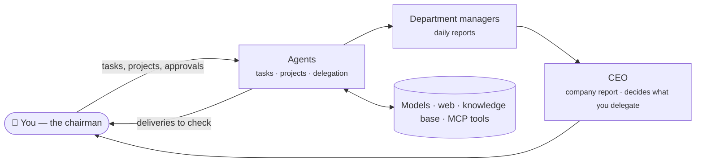

<div align="center">

# Barnacle

**A self-hosted pixel office where your AI agents work as a team.**

[](LICENSE)
[](#from-source)
[](#docker)
[](docs/guide.md#mcp-tools)
[](docs/REQUIREMENTS.md)

**English** · [简体中文](README.zh-CN.md)

[Quick start](#quick-start) · [Features](#features) · [How it works](#how-it-works) · [Guide](docs/guide.md) · [Roadmap](#roadmap)

</div>

<br>


<br>

Barnacle turns your AI agents into a small company you can **watch**. Each agent
has a job title, a soul and skills, a desk in a department, and a pixel
character that walks to its desk to write, to the library to research and to
the server room to run things. They hand work to each other, discuss projects
in threads, report to their managers every evening — and bring you, the
**chairman**, only what you need to decide.

It runs on your own server, NAS or laptop, with any model you like.

## Features

<table>
<tr>
<td width="50%" valign="top">

### 🧠 Agents with a soul
Job title, persona (SOUL), way of working and a skill library — each agent with
its own model. Layered memory and full-text recall of everything they did.

</td>
<td width="50%" valign="top">

### 🤝 A team, not a list of bots
Agents ask colleagues and delegate pieces of work. Projects run as threads where
an @mention hands the work on, with a planner and a summary.

</td>
</tr>
<tr>
<td valign="top">

### 🏢 A company structure
Rooms are departments with managers who write daily reports. A CEO sums them up
and decides what you delegate, following your own earlier decisions.

</td>
<td valign="top">

### ✋ You stay in charge
Allow / ask me / never, per action. One inbox for approvals; a results page to
accept or send back every delivery, with the sources it read.

</td>
</tr>
<tr>
<td valign="top">

### 📎 Real work in and out
Attach PDF, Word, Excel, PowerPoint and images. A company and per-department
knowledge base with citations. Deliveries as Word, Excel, CSV or Markdown.

</td>
<td valign="top">

### 💸 Costs under control
Tokens and estimated cost for every call, by person, department and model.
Daily and monthly budgets; a lighter model for routine work.

</td>
</tr>
<tr>
<td valign="top">

### 🔌 Connect your tools
MCP servers (local or remote), each tool behind the same approval rules.
Scheduled tasks, a Claude Code hook and a simple HTTP state API.

</td>
<td valign="top">

### 🧱 Your office, your layout
A tile-based floor editor, desks that belong to people, and a "start a company"
wizard with team templates. English, 日本語 and 繁體中文.

</td>
</tr>
</table>

**Models:** Claude, OpenAI, Gemini, DeepSeek, MiniMax, OpenRouter, Ollama, LM
Studio, vLLM — anything with an Anthropic or OpenAI-compatible API.
**Also in the office:** Claude Code, Codex or any tool that can send an HTTP request.

## Quick start

### Docker

```bash
git clone https://github.com/xiaoxiongbaba/barnacle.git
cd barnacle
docker compose up -d
docker compose logs barnacle | grep "office token"
```

### From source

Requires Node.js 22.13 or later.

```bash
git clone https://github.com/xiaoxiongbaba/barnacle.git
cd barnacle
npm install
npm run build
npm start
```

Then open <http://localhost:19100>:

1. Click the ⚙️ gear (top right) and enter the **office token** — it is printed
   once in the log on first start and kept in `data/secret.json`.
2. The **Start a company** wizard connects a model and creates a team from a
   template: members with souls and skills, managers, an optional CEO and
   scheduled work.
3. Click anyone to give them a task, or open a project for the whole team.

## How it works



Every tool call passes the office's rules first: allowed, waiting for your
approval (or the CEO's, if you delegated it), or refused. Budgets are checked
before every step. The [guide](docs/guide.md) explains each part.

## Bring in your agents

- **Agents in Barnacle** — give any member a model in Settings → Occupants, then
  hand it tasks from its panel, schedule work, or start a project.
- **Claude Code** — hooks that show what Claude Code is doing:
  [integrations/claude-code](integrations/claude-code/README.md).
- **Anything else** that can send an HTTP request:

  ```bash
  curl -X POST http://localhost:19100/api/occupants/me/status \
    -H "Authorization: Bearer $BARNACLE_TOKEN" \
    -H "Content-Type: application/json" \
    -d '{"state":"writing","detail":"Sketching the lobby","name":"Me","kind":"human"}'
  ```

  States: `idle` · `writing` · `researching` · `executing` · `syncing` ·
  `waiting` (needs you) · `error` · `offline` — see the [state protocol](docs/state-protocol.md).

## Configuration

Most settings live in the page; the environment sets the defaults.

| Variable         | Default       | Meaning                                   |
| ---------------- | ------------- | ----------------------------------------- |
| `PORT`           | `19100`       | HTTP port                                 |
| `HOST`           | `0.0.0.0`     | Bind address                              |
| `DATA_DIR`       | `./data`      | Database, encryption key and token        |
| `BARNACLE_TOKEN` | generated     | Office token, at least 32 characters      |
| `BARNACLE_NAME`  | `My Barnacle` | Default office name                       |
| `BARNACLE_LANG`  | `en`          | Default language: `en`, `ja` or `zh-Hant` |

All variables are in the [guide](docs/guide.md#environment-variables). Back up
the whole `DATA_DIR`: the database and `master.key` belong together.

## Security

> [!IMPORTANT]
> **Viewing the office needs no login yet (v0.1).** Keep the port on your LAN,
> or behind a VPN or a reverse proxy with authentication.

- No default credentials: the office token is random per install, and changing
  anything needs it.
- API keys and MCP secrets are encrypted at rest and never sent to the browser.
- Agents act for you — they call model providers, read the web and use the MCP
  servers you connect. Permissions, per-tool MCP rules and budgets keep them in check.

See [SECURITY.md](SECURITY.md); please report vulnerabilities privately.

## Roadmap

- [x] Agents with souls, skills, memory and models
- [x] Delegation, project threads, departments, managers, CEO, chairman's desk
- [x] Approvals, reviews, experience library, scheduled tasks
- [x] Files and knowledge base, costs and budgets, MCP tools
- [x] Manager review and employee profiles
- [ ] Export and import team templates
- [ ] Viewing passwords for the office
- [ ] Agents on other machines (remote nodes)
- [ ] **Whale** — a shared building where offices visit each other

The full checklist is in [docs/REQUIREMENTS.md](docs/REQUIREMENTS.md) (Chinese).

## Documentation

| | |
| --- | --- |
| [Guide](docs/guide.md) | Every feature in detail, environment variables, art packs |
| [State protocol](docs/state-protocol.md) | How anything reports its state (draft v0.1) |
| [Mod pack spec](docs/mod-pack-spec.md) | How anyone can decorate an office (draft v0.1) |
| [Requirements](docs/REQUIREMENTS.md) | Feature checklist and roadmap (Chinese) |

## Contributing

Issues and pull requests are welcome. For larger changes, please open an issue
first to talk about the idea. Run `npm run build` before sending a pull request
(it type-checks the server and the page), and never commit `data/` or anything
under `packs/local/`.

## Credits

The built-in pixel art — characters, furniture, floors and walls, all drawn in
code — comes from [Habblaud](https://github.com/marmottajr/habblaud) by Márcio
Junior, vendored under its MIT licence in `web/src/vendor/habblaud/`. Ideas
borrowed from [Star Office UI](https://github.com/ringhyacinth/Star-Office-UI),
OpenClaw, Hermes Agent and Clawith. The Pixelify Sans font is under the SIL Open
Font License. No third-party image assets are included; see [NOTICE](NOTICE).

## License

[Apache-2.0](LICENSE) © 2026 [xiaoxiongbaba](https://github.com/xiaoxiongbaba)
