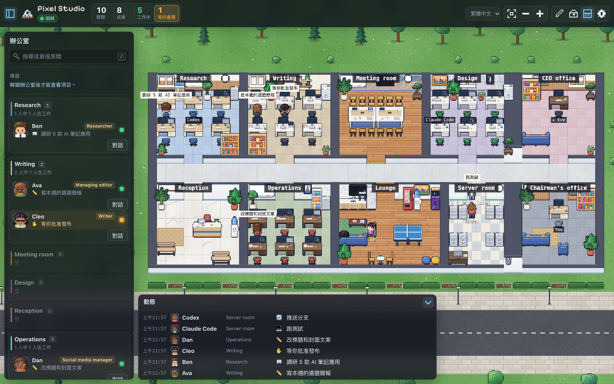
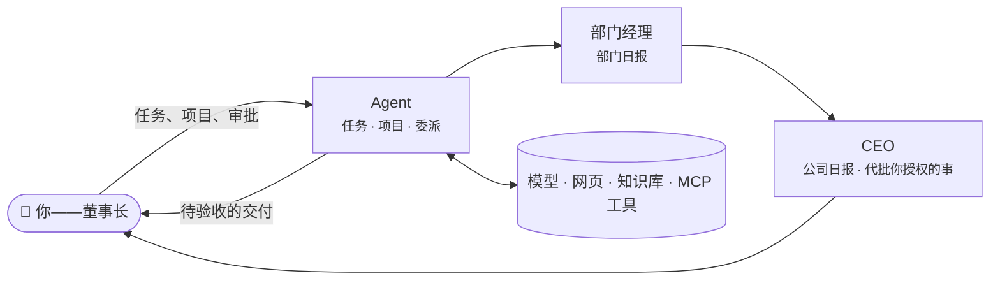

<div align="center">

# Barnacle

**一个自托管的像素办公室，让你的 AI Agent 像团队一样协作。**

[](LICENSE)
[](#从源码运行)
[](#docker)
[](docs/guide.md#mcp-tools)
[](docs/REQUIREMENTS.md)

[English](README.md) · **简体中文**

[快速开始](#快速开始) · [功能](#功能) · [工作方式](#工作方式) · [使用指南](docs/guide.md) · [路线图](#路线图)

</div>

<br>



<br>

Barnacle 把你的 AI Agent 变成一家**看得见**的小公司。每个 Agent 有自己的职位、灵魂和技能，在某个部门有固定工位，还有一个像素小人：写东西时坐回工位，查资料时去图书区，跑任务时去机房。它们互相求助、委派工作，在项目讨论串里接力，每天傍晚向部门经理汇报——只把真正需要你拍板的事，送到你这位**董事长**的桌上。

可以部署在自己的服务器、NAS 或笔记本上，模型随你选。

## 功能

<table>
<tr>
<td width="50%" valign="top">

### 🧠 有灵魂的 Agent
职位、人设（SOUL）、工作方式和技能库，每人可用不同模型；分层记忆，能全文检索做过的每件事。

</td>
<td width="50%" valign="top">

### 🤝 团队，而不是一堆机器人
Agent 会向同事提问、委派部分工作；项目以讨论串进行，@ 谁就交给谁，自动规划与总结。

</td>
</tr>
<tr>
<td valign="top">

### 🏢 公司架构
房间即部门，部门经理每天写日报；CEO 汇总全公司，并依照你过去的决定，代你审批你授权的事。

</td>
<td valign="top">

### ✋ 你始终掌控
每类动作可设「允许 / 先问我 / 禁止」；收件箱集中审批；成果页逐件验收或退回，并能看到它引用的来源。

</td>
</tr>
<tr>
<td valign="top">

### 📎 真实的工作输入输出
任务可附 PDF、Word、Excel、PowerPoint 和图片；公司与部门知识库，检索并标明出处；交付 Word、Excel、CSV 或 Markdown 文件。

</td>
<td valign="top">

### 💸 成本可控
每次调用记录 token 与估算费用，按人、部门、模型汇总；每日 / 每月预算；例行工作改用轻量模型。

</td>
</tr>
<tr>
<td valign="top">

### 🔌 接入你的工具
MCP 服务器（本机或远程），每个工具都走同一套审批规则；定时任务、Claude Code hook 和简单的 HTTP 状态接口。

</td>
<td valign="top">

### 🧱 自己设计办公室
瓦片式楼层编辑器、属于个人的工位，「开公司向导」内置团队模板。界面支持 English、日本語、繁體中文。

</td>
</tr>
</table>

**支持的模型：** Claude、OpenAI、Gemini、DeepSeek、MiniMax、OpenRouter、Ollama、LM Studio、vLLM——任何 Anthropic 或 OpenAI 兼容接口。
**也能进办公室的：** Claude Code、Codex，或任何能发 HTTP 请求的工具。

## 快速开始

### Docker

```bash
git clone https://github.com/xiaoxiongbaba/barnacle.git
cd barnacle
docker compose up -d
docker compose logs barnacle | grep "office token"
```

### 从源码运行

需要 Node.js 22.13 或更高版本。

```bash
git clone https://github.com/xiaoxiongbaba/barnacle.git
cd barnacle
npm install
npm run build
npm start
```

然后打开 <http://localhost:19100>：

1. 点右上角 ⚙️ 齿轮，输入**办公室令牌**——首次启动时在日志里打印一次，并保存在 `data/secret.json`。
2. 「开公司向导」会帮你接入模型，并按模板建好团队：带灵魂和技能的成员、部门经理、可选的 CEO 和定时工作。
3. 点任意一个人派任务，或者为整个团队开一个项目。

## 工作方式



每次调用工具都要先过办公室的规则：直接允许、等你批准（若已授权则由 CEO 代批），或者拒绝。每一步之前都会检查预算。各部分的详细说明见[使用指南](docs/guide.md)。

## 接入你的 Agent

- **Barnacle 里的 Agent**——在 设置 → 成员 里给成员配置模型，然后在它的面板里派任务、设定时任务，或发起项目。
- **Claude Code**——用 hook 显示 Claude Code 正在做什么，见 [integrations/claude-code](integrations/claude-code/README.md)。
- **其他任何能发 HTTP 请求的程序**：

  ```bash
  curl -X POST http://localhost:19100/api/occupants/me/status \
    -H "Authorization: Bearer $BARNACLE_TOKEN" \
    -H "Content-Type: application/json" \
    -d '{"state":"writing","detail":"画大厅草图","name":"我","kind":"human"}'
  ```

  状态：`idle` · `writing` · `researching` · `executing` · `syncing` · `waiting`（需要你）· `error` · `offline`，详见[状态协议](docs/state-protocol.md)。

## 配置

大部分设置都在网页里改，环境变量只提供默认值。

| 变量             | 默认值        | 说明                              |
| ---------------- | ------------- | --------------------------------- |
| `PORT`           | `19100`       | HTTP 端口                         |
| `HOST`           | `0.0.0.0`     | 监听地址                          |
| `DATA_DIR`       | `./data`      | 数据库、加密密钥和令牌            |
| `BARNACLE_TOKEN` | 自动生成      | 办公室令牌，至少 32 个字符        |
| `BARNACLE_NAME`  | `My Barnacle` | 默认办公室名称                    |
| `BARNACLE_LANG`  | `en`          | 默认语言：`en`、`ja` 或 `zh-Hant` |

完整列表见[指南](docs/guide.md#environment-variables)。请备份整个 `DATA_DIR`：数据库和 `master.key` 必须一起保存。

## 安全

> [!IMPORTANT]
> **查看办公室目前不需要登录（v0.1）。** 请只在局域网内开放端口，或放在 VPN / 带认证的反向代理后面。

- 没有默认密码：每次安装的办公室令牌都是随机的，任何修改都需要它。
- API Key 和 MCP 密钥加密保存，绝不发送到浏览器。
- Agent 代表你行动——会调用模型、读取网页、使用你接入的 MCP 服务器。用权限设置、MCP 逐工具规则和预算约束它们。

详见 [SECURITY.md](SECURITY.md)，发现漏洞请私下报告。

## 路线图

- [x] 有灵魂、技能、记忆和模型的 Agent
- [x] 委派、项目讨论串、部门、经理、CEO、董事长工作台
- [x] 审批、验收、经验库、定时任务
- [x] 文件与知识库、成本与预算、MCP 工具
- [ ] 经理初审与员工档案
- [ ] 团队模板导出 / 导入
- [ ] 查看办公室的访问密码
- [ ] 控制其他电脑上的 Agent（远程节点）
- [ ] **Whale**——各个办公室可以互相拜访的共享大楼

完整清单见 [docs/REQUIREMENTS.md](docs/REQUIREMENTS.md)。

## 文档

| | |
| --- | --- |
| [使用指南](docs/guide.md)（英文） | 每个功能的详细说明、环境变量、美术包 |
| [状态协议](docs/state-protocol.md) | 任何程序如何上报状态（草案 v0.1） |
| [Mod 包规范](docs/mod-pack-spec.md) | 任何人都能装修办公室（草案 v0.1） |
| [需求清单](docs/REQUIREMENTS.md) | 功能清单与路线图 |

## 参与贡献

欢迎提 Issue 和 Pull Request。较大的改动请先开 Issue 讨论。提交 PR 前请运行 `npm run build`（会对服务端和网页做类型检查），不要提交 `data/` 或 `packs/local/` 下的任何文件。

## 致谢

内置像素美术（人物、家具、地板和墙，全部用代码绘制）来自 Márcio Junior 的 [Habblaud](https://github.com/marmottajr/habblaud)，以 MIT 协议收录在 `web/src/vendor/habblaud/`。思路借鉴了 [Star Office UI](https://github.com/ringhyacinth/Star-Office-UI)、OpenClaw、Hermes Agent 和 Clawith。Pixelify Sans 字体采用 SIL Open Font License。仓库不包含任何第三方图片素材，见 [NOTICE](NOTICE)。

## 开源协议

[Apache-2.0](LICENSE) © 2026 [xiaoxiongbaba](https://github.com/xiaoxiongbaba)
